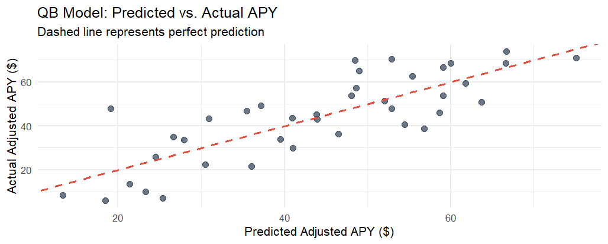
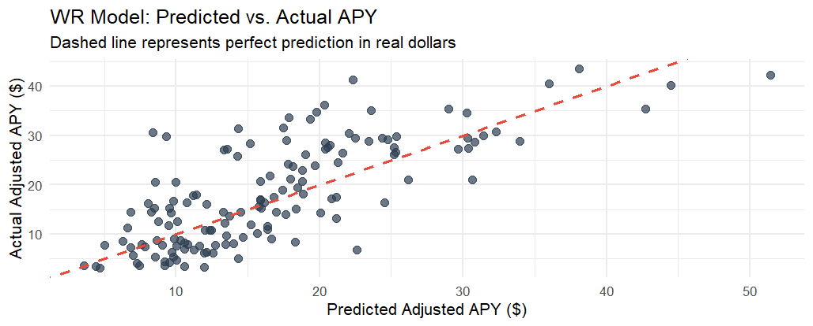
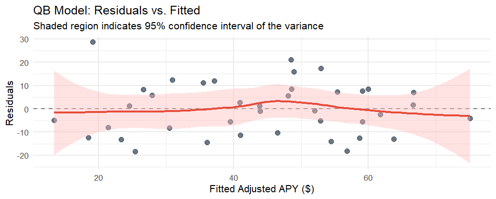
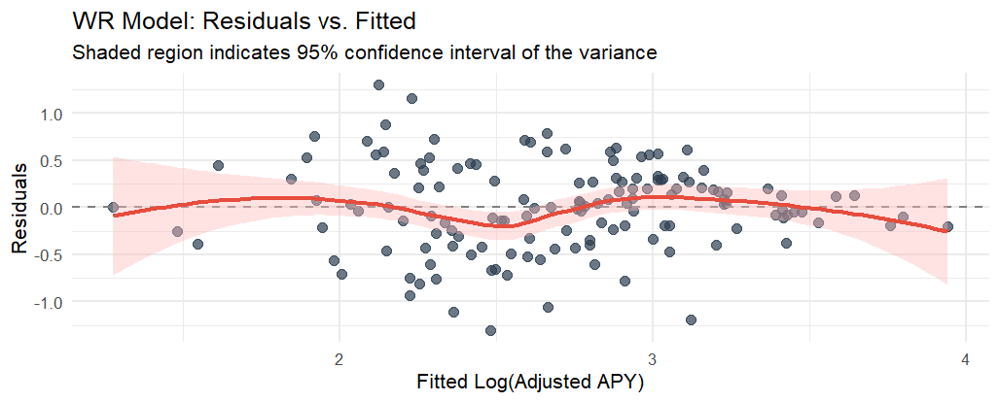

# NFL Salary vs Performance (STAT 7210)

Group project for STAT 7210 (Regression) at Kennesaw State, done with Favour Adekunle. We used multiple linear regression to look at which stats actually drive salaries for NFL quarterbacks and wide receivers.

## Data

Pulled with the `nflreadr` package (nflverse) for the 2011–2025 seasons. `nfl_dataset_creation.R` builds the datasets.

A few decisions we made:
- Only used each player's **first contract after their rookie deal**, since rookie contracts are basically fixed
- Adjusted all salaries to the **2026 salary cap**. A $10M deal in 2011 isn't the same as $10M now
- Dropped anyone under **$3M/year** to remove backups and depth players

That left 39 QB contracts and 142 WR contracts (`data/` folder).

## Models

**QB model**

With only 39 QBs we had to keep it small:

`salary ~ passing TDs + completion rate + rushing yards`

- R² = 0.655 (adj. 0.626)
- Rushing yards ended up being a really strong predictor, so teams pay a lot for QBs who can run
- VIFs were all under 2, so no multicollinearity issues

**WR model**

We log-transformed salary, so the coefficients read as percent changes:

`log(salary) ~ targets + yards per target + age`

- R² = 0.531 (adj. 0.521)
- Each extra target → about +0.86% salary
- Each extra yard per target → about +12%
- Each year older → about -8.7%. Age hurts WRs a lot since speed is the whole job

## Diagnostics

We checked normality, constant variance (Breusch-Pagan), independence, outliers and VIF. The WR model failed Breusch-Pagan, and there's a visible diagonal edge in the residual plot. We think that comes from the $3M cutoff (it's truncated data). We tried splines, polynomials, square root and log-log, but they either overfit or caused multicollinearity, so we kept the simpler model.

| QB | WR |
|---|---|
|  |  |
|  |  |

## Files

- `nfl_dataset_creation.R` - pulls and builds the data
- `nfl_salary_models.R` - EDA, models, diagnostics
- `proposal_exploration.R` - early stuff from the proposal stage
- `data/` - final QB and WR datasets
- `docs/` - knitted report (html/pdf) and our poster

Packages: tidyverse, nflreadr, car, lmtest, ggcorrplot, ggfortify, gridExtra, effects

## Future ideas

- Truncated regression to deal with the salary cutoff properly
- LASSO/Ridge for the QB model since the sample is so small
- Looking at players across multiple contracts instead of just one
